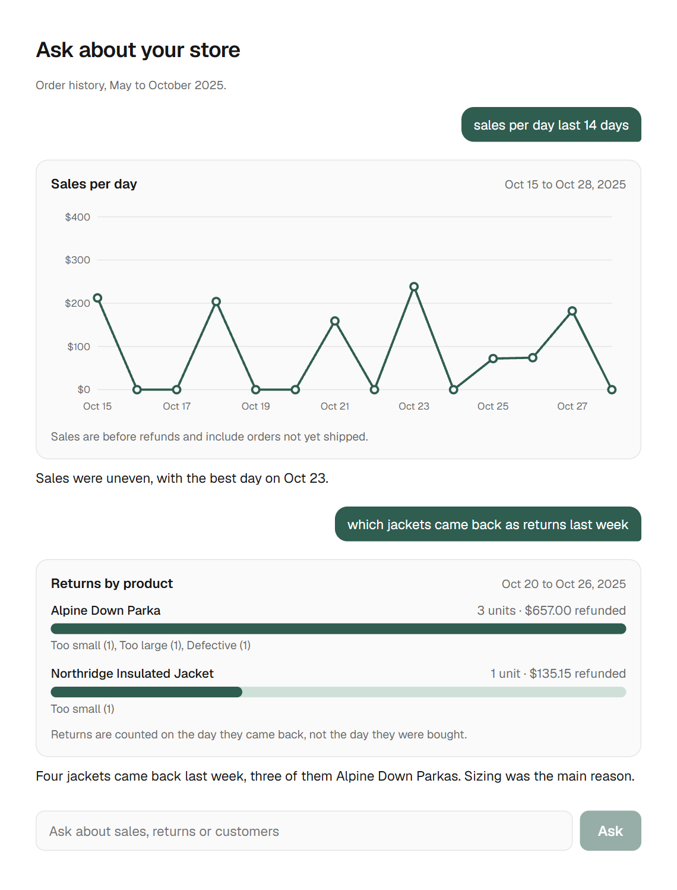

# Merchant metrics

Six metric functions over the Shopify order history, May to October 2025 (`data/orders.csv`, 28 lines). Each takes `start` and `end` (`YYYY-MM-DD`, inclusive).

| Metric | Function | Counts | Dated by |
| --- | --- | --- | --- |
| `daily_sales` | `dailySales` | sum of `line_total`, orders, units per day | `order_date` |
| `new_customers` | `newCustomers` | distinct `customer_id` with `is_repeat_customer = false` | `order_date` |
| `returning_customers` | `returningCustomers` | distinct `customer_id` with `is_repeat_customer = true` | `order_date` |
| `returns_by_product` | `returnsByProduct` | units returned, `refund_amount`, reasons per product | `return_date` |
| `units_sold_by_product` | `unitsSoldByProduct` | units and sales per product (reorder planning) | `order_date` |
| `returned_order_lines` | `returnedOrderLines` | each returned line: product, variant, return date, reason, refund | `return_date` |

Notes: sales are gross (before refunds) and include unfulfilled lines. Returns use `return_date`, so a jacket bought in September and returned last week counts last week.

## Turning "last week" into dates

`resolveDateRange(phrase, referenceDate)` in `lib/dates.ts`. Weeks run Monday to Sunday.

| Phrase | Range |
| --- | --- |
| `last week` | previous full Monday to Sunday |
| `this week` / `this month` | start of period to the reference date |
| `last 7 days` / `last 30 days` | ending on the reference date, inclusive |
| `yesterday` / `today` | that single day |
| `last month` | the previous calendar month |

The reference date is always passed in, never read inside the function, so results are repeatable. The data ends on 2025-10-27, so the demo page uses 2025-10-28 as "today".

## Chat route

`POST /api/chat` (`app/api/chat/route.ts`) connects an OpenRouter model to the five metric tools with the Vercel AI SDK. It streams the answer. The model makes one tool call with exact `YYYY-MM-DD` dates, then explains the result in plain words.

The six tools are described in merchants' words (`lib/chat.ts`), for example `returns_by_product`: "Which products came back as returns, counted on the day they were returned." The system prompt tells the model today's date, that weeks run Monday to Sunday, and lists ready-made ranges from `resolveDateRange`. For "today" = 2025-10-28, "last week" is 2025-10-20 to 2025-10-26.

Questions about ads, ad spend or ROAS, or dates before May 2025, get a plain "we don't have that data" and no tool call.

### Set up the key

1. Create a key at https://openrouter.ai/settings/keys and pick a free model that supports tools (filter models by Free and tools).
2. Copy `.env.example` to `.env.local` and fill it in:

   ```
   OPENROUTER_API_KEY=sk-or-v1-...
   OPENROUTER_MODEL=provider/model-name:free
   ```

`.env.local` is git-ignored and only read on the server (no `NEXT_PUBLIC_` prefix). Never commit the key. If it leaks, delete it in OpenRouter and make a new one.

`REFERENCE_DATE` (optional) sets the "today" used for date phrases. It defaults to 2025-10-28, and a request body can override it with `today`.

### Try it

```
npm run dev
curl -N http://localhost:3000/api/chat -H "Content-Type: application/json" -d '{
  "messages": [{
    "id": "1", "role": "user",
    "parts": [{ "type": "text", "text": "which jackets came back as returns last week" }]
  }]
}'
```

Expected: one `returns_by_product` call with `start: "2025-10-20"` and `end: "2025-10-26"`, then a short answer about the Alpine Down Parka (3 units, $657) and the Northridge Insulated Jacket (1 unit, $135.15). The response is a stream of AI SDK UI message events.

If the key or model is missing, the route returns a 500 with a message saying what to set.

## Dashboard

The page at `/` is a chat. Each answer shows, in order: the dates used, a chart for that metric, one or two plain sentences, and a small note on what the numbers include. Code is in `app/_components`.



*The screenshot was taken with a scripted model reply, so no API key was needed. The charts and numbers come from the real metric functions.*

| Metric | Chart | Why |
| --- | --- | --- |
| `daily_sales` | Line | It's a trend over days, and a line shows the ups and downs. |
| `units_sold_by_product` | Bars | It compares products, ranked from most to least sold, for reorders. |
| `returns_by_product` | Bars | It compares products, so the most-returned jackets stand out. Reasons and refunds sit under each bar. |
| `new_customers` | Metrics cards | Over a week it's a few small numbers, so a total, a per-day average and the busiest day read faster than a chart. |
| `returning_customers` | Metrics cards | Same as new customers. |
| `returned_order_lines` | Table | The seller reads each row: product, variant, return date and reason. |

States:

- **Loading:** while a tool call streams, the answer shows a grey placeholder in the same shape as the chart, so the layout doesn't jump when the real chart arrives.
- **Tool call fails:** the placeholder becomes "Couldn't load this chart. Try asking again."
- **Request fails:** a short message appears under the chat, and the question box keeps working.
- **No tool called:** questions about ads, ROAS or dates before May 2025 get the plain-text answer only.
- **No orders in the dates:** the card says "No orders in these dates."
## Use

```
npm install
npm test
npm run dev
```

- Dashboard: `/`. The raw report from before the chat is at `/report` (try `/report?range=last month&today=2025-10-28`)
- API: `/api/metrics/returns_by_product?start=2025-10-20&end=2025-10-26`
- API with a phrase: `/api/metrics/daily_sales?range=last week&today=2025-10-28`


## Output for last week

Run with `npm run last-week` (reference date 2025-10-28, so last week is Mon 2025-10-20 to Sun 2025-10-26).

```text
"last week" as of 2025-10-28 -> 2025-10-20 to 2025-10-26

$ daily_sales("2025-10-20", "2025-10-26")
[
  {
    "date": "2025-10-20",
    "sales": 0,
    "orders": 0,
    "units": 0
  },
  {
    "date": "2025-10-21",
    "sales": 159,
    "orders": 1,
    "units": 1
  },
  {
    "date": "2025-10-22",
    "sales": 0,
    "orders": 0,
    "units": 0
  },
  {
    "date": "2025-10-23",
    "sales": 238.5,
    "orders": 1,
    "units": 2
  },
  {
    "date": "2025-10-24",
    "sales": 0,
    "orders": 0,
    "units": 0
  },
  {
    "date": "2025-10-25",
    "sales": 72,
    "orders": 1,
    "units": 3
  },
  {
    "date": "2025-10-26",
    "sales": 74,
    "orders": 1,
    "units": 1
  }
]

$ new_customers("2025-10-20", "2025-10-26")
[
  {
    "date": "2025-10-20",
    "customers": 0
  },
  {
    "date": "2025-10-21",
    "customers": 0
  },
  {
    "date": "2025-10-22",
    "customers": 0
  },
  {
    "date": "2025-10-23",
    "customers": 1
  },
  {
    "date": "2025-10-24",
    "customers": 0
  },
  {
    "date": "2025-10-25",
    "customers": 0
  },
  {
    "date": "2025-10-26",
    "customers": 1
  }
]

$ returning_customers("2025-10-20", "2025-10-26")
[
  {
    "date": "2025-10-20",
    "customers": 0
  },
  {
    "date": "2025-10-21",
    "customers": 1
  },
  {
    "date": "2025-10-22",
    "customers": 0
  },
  {
    "date": "2025-10-23",
    "customers": 0
  },
  {
    "date": "2025-10-24",
    "customers": 0
  },
  {
    "date": "2025-10-25",
    "customers": 1
  },
  {
    "date": "2025-10-26",
    "customers": 0
  }
]

$ returns_by_product("2025-10-20", "2025-10-26")
[
  {
    "productId": "P-1001",
    "productTitle": "Alpine Down Parka",
    "productCategory": "Outerwear",
    "unitsReturned": 3,
    "refundAmount": 657,
    "reasons": {
      "Too small": 1,
      "Too large": 1,
      "Defective": 1
    }
  },
  {
    "productId": "P-1002",
    "productTitle": "Northridge Insulated Jacket",
    "productCategory": "Outerwear",
    "unitsReturned": 1,
    "refundAmount": 135.15,
    "reasons": {
      "Too small": 1
    }
  }
]

$ units_sold_by_product("2025-10-20", "2025-10-26")
[
  {
    "productId": "P-1010",
    "productTitle": "Wool Beanie",
    "productCategory": "Accessories",
    "unitsSold": 3,
    "sales": 72
  },
  {
    "productId": "P-1002",
    "productTitle": "Northridge Insulated Jacket",
    "productCategory": "Outerwear",
    "unitsSold": 1,
    "sales": 159
  },
  {
    "productId": "P-1001",
    "productTitle": "Alpine Down Parka",
    "productCategory": "Outerwear",
    "unitsSold": 1,
    "sales": 197.1
  },
  {
    "productId": "P-1011",
    "productTitle": "Leather Gloves",
    "productCategory": "Accessories",
    "unitsSold": 1,
    "sales": 41.4
  },
  {
    "productId": "P-1009",
    "productTitle": "Utility Chino",
    "productCategory": "Bottoms",
    "unitsSold": 1,
    "sales": 74
  }
]
```
